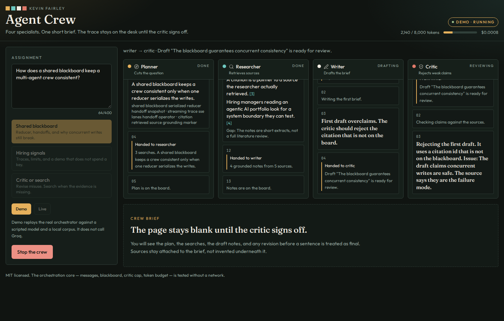
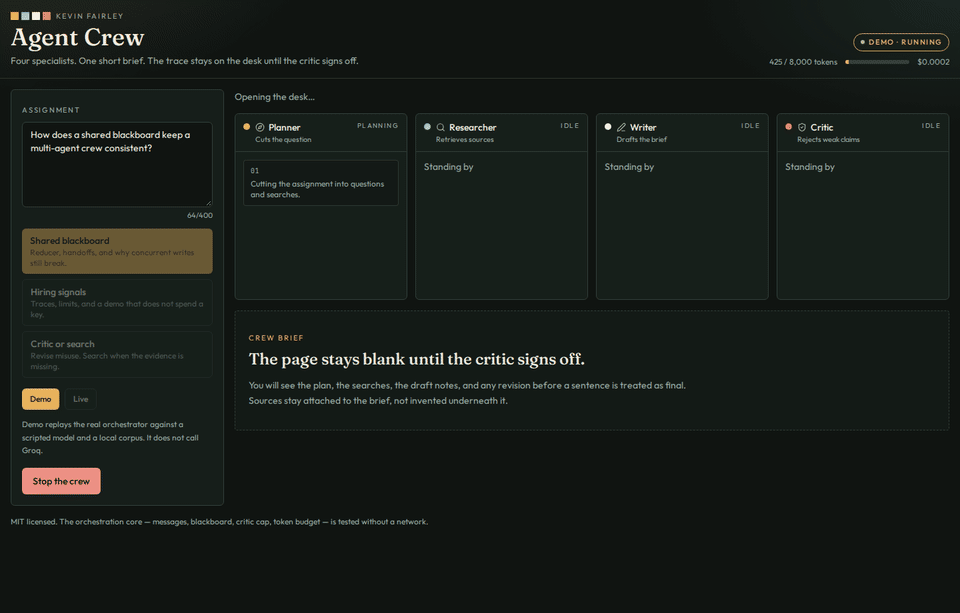
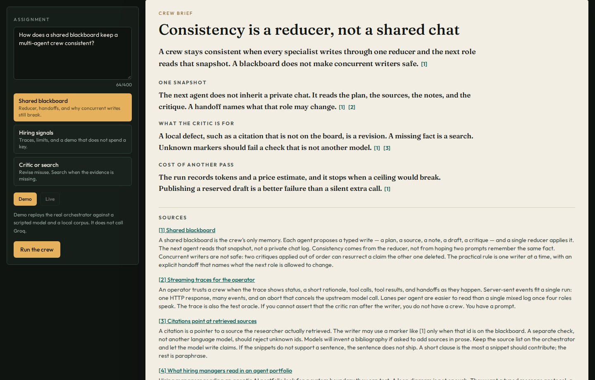
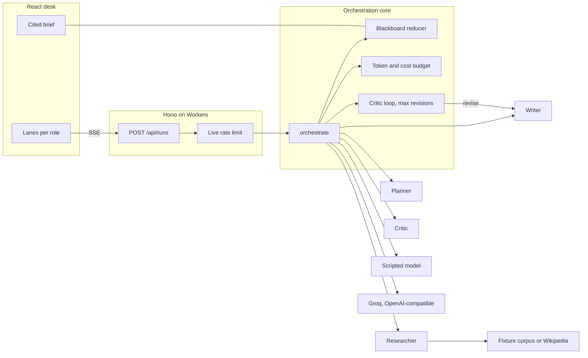

# Agent Crew

A planner, a researcher, a writer, and a critic take one assignment and come back with a short brief you can check. You watch the handoffs while they work. The sources under the brief are the ones the researcher actually retrieved.

This is a portfolio project by **Kevin Fairley** for agentic AI roles: a typed orchestration core, a streaming desk, and a demo that does not spend an API key.








## What it does

You assign a question. Four roles share one blackboard:

1. **Planner** cuts the question into searches.
2. **Researcher** calls a search tool and keeps only notes those hits support.
3. **Writer** drafts a brief whose markers look like `[1]`.
4. **Critic** sends it back when a claim or a citation does not hold.

The loop stops at a revision cap (default 2). A separate check, not another model, rejects citation ids that were never retrieved. A token and dollar budget is checked before each model call and again after the usage comes back. If the ceiling would break, the crew publishes what it has and says why it stopped.

The desk streams status, short rationales, tool calls, tool results, and handoffs over server-sent events. Lanes are one per role. The paper stays blank until the critic signs off.

## Architecture

The orchestrator does not know it is running on a Worker. The same function drives unit tests, demo playback, and a live Groq call.



| Piece | Where | Notes |
| --- | --- | --- |
| Messages, blackboard, critic cap, budget | `src/core` | No React, Hono, or Worker imports |
| Scripted model and presets | `src/demo` | Same orchestrator, recorded answers |
| Groq client | `src/llm` | User-Agent, 429 retry, token-bucket reset |
| Search | `src/tools` | Local corpus, or Wikipedia with no key |
| API | `src/worker` | Static assets plus `/api/*` |
| Desk | `src/client` | Vite, Tailwind, shadcn-style primitives |

On Cloudflare, `/api/*` runs the Worker first. Everything else is the Vite build, with SPA fallback. Logs and traces are enabled in `wrangler.jsonc`.

## Quickstart

Node 22 or newer.

```bash
npm install
npm run dev
```

Open [http://127.0.0.1:43123](http://127.0.0.1:43123). Pick a preset and run the crew. Demo mode is the default. It does not call Groq.

```bash
npm test          # vitest: orchestration, budget, 429 parser, API
npm run test:e2e  # Playwright against the built desk in demo mode
npm run typecheck # wrangler types, then tsc
npm run build
```

`npm run dev` is Vite on port 43123 plus the Hono app on port 44731. `npm run preview` serves the production build and the API on one port, which is what the smoke test uses. `npm run dev:worker` is `wrangler dev` after a build.

## Demo mode and live mode

Demo is the public path. With no `GROQ_API_KEY`, live requests are rejected. The scripted model is not a fake event tape: it answers the same JSON schemas the live model is asked for, including a first draft that cites a source the researcher never retrieved. The critic sends that back. The second draft cites only real ids. Playback delays live in the HTTP layer, so tests run the loop with no sleeps.

Live mode is opt-in in the UI, and only if the secret is present.

- Provider: OpenAI-compatible chat completions
- Default base URL: `https://api.groq.com/openai/v1`
- Default model: `qwen/qwen3.8-27b` (`GROQ_MODEL` overrides it)
- Every request sets `User-Agent: AgentCrew/1.0 (Kevin Fairley portfolio; +https://github.com/kfairy9999)`. Groq's edge blocks empty and library-default agents.
- A 429 waits for the later of `Retry-After`, `x-ratelimit-reset-tokens`, and `x-ratelimit-reset-requests` (durations like `250ms`, `7.66s`, `6m0s`). The client will not block past 15 seconds. The provider message "try again in 1.2s" is a fallback when headers are missing.
- Search in live mode is the Wikipedia API. No second key. It sends the same user agent, which Wikimedia requires.
- Live runs are rate limited: 2 per 10 minutes per IP, and 4 per 10 minutes for the isolate. That map dies with the isolate. It is a guardrail, not an account-wide limiter. The per-run budget defaults to 8,000 tokens and $0.05 at the planning rates in `wrangler.jsonc`.

Copy `.dev.vars.example` to `.dev.vars` for local live mode. Do not commit the key.

## Deploy

This repo is ready to deploy and has not been deployed from here. A dry run bundles the Worker and the static assets locally.

Demo-only (no key, no spend):

```bash
npm ci
npm run build
npx wrangler login
npx wrangler deploy
```

Live mode, after the demo deploy is up:

```bash
npx wrangler secret put GROQ_API_KEY
```

`wrangler secret put` creates a new version and deploys it. The secret is not in `wrangler.jsonc`. `secrets.required` only names `GROQ_API_KEY` so `wrangler types` knows it exists. An empty secret keeps the desk in demo mode.

Useful checks before you ship a change:

```bash
npx wrangler types
npx wrangler deploy --dry-run
```

Config worth knowing:

- `compatibility_date` is `2026-11-08`, with `nodejs_compat`
- `assets.run_worker_first` is `["/api/*"]`
- `observability.logs` and `observability.traces` are on
- Preview URLs on `workers.dev` are public unless you put Access in front of them

## What I learned

The interesting bugs were not in the prompts.

A critic that can only say "revise" will revise forever. The cap has to be in the orchestrator, and the unresolved issues have to ship with the brief. Otherwise the trace hides the disagreement.

Citation ids cannot be the model's job. If the writer is allowed to emit a bibliography, it will invent one. The source list stays on the blackboard. A pure function rejects unknown markers even when the critic approves.

The budget check has to happen twice. An estimate before the call keeps you from starting a request you cannot afford. The usage object after the call catches the estimate being wrong. Stopping there is a successful run, if you still publish the draft you have.

Demo mode was tempting to fake in the UI. Playing a script through the real loop meant the smoke test and the unit tests exercise one code path. The script's job is to be wrong once, on purpose.

Groq's 429 is two buckets. `Retry-After` alone was not enough. The token reset header is often the longer wait, and it is a duration string, not a number of seconds. I also had to send a User-Agent. The default agent is blocked before the model sees the body.

SSE on one request is enough for a run that finishes in seconds. The abort signal has to reach `fetch`, or a visitor who hits Stop still spends the key. I would not use this shape for a run that must survive a disconnected tab. That wants a Durable Object or a Workflow, and it can wait until a run is actually longer than a request.

The isolate-local rate limit will not save a key from a determined client that lands on fresh isolates. The budget and the "demo unless a secret is set" switch are the controls that matter. The limiter is there so a single warm isolate cannot be used as an open proxy.

## Roadmap

- A Durable Object so a refresh can reattach to a run instead of starting over
- A second provider behind the same `LlmClient`, including Workers AI
- Search that can fail on purpose in the eval set, not only in a mock
- Score the mechanical checks across a frozen set of topics before asking another model to grade prose
- Per-user budgets once there is an account, instead of an isolate map

## License

MIT. See [LICENSE](LICENSE).
